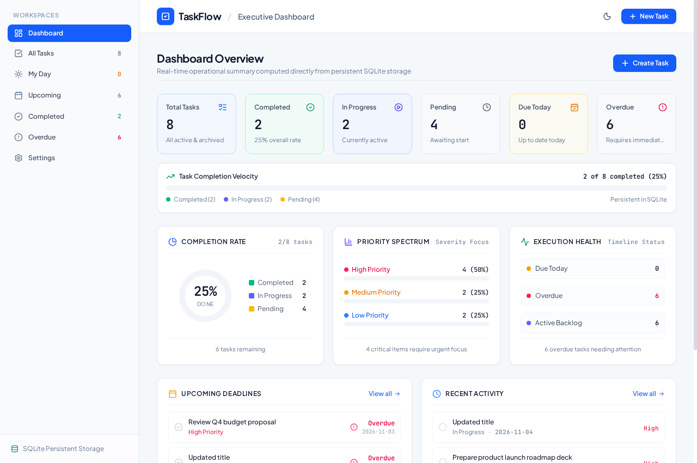

# TaskFlow — Full-Stack Task List Application

🔗 **Live Published Application:** [https://remix-taskflow-full-stack-task-management-438938880626.asia-southeast1.run.app](https://remix-taskflow-full-stack-task-management-438938880626.asia-southeast1.run.app)

[](https://remix-taskflow-full-stack-task-management-438938880626.asia-southeast1.run.app)
[](https://github.com)
[](https://www.typescriptlang.org/)
[](https://tailwindcss.com/)
[](LICENSE)

> 🚀 **Live Demo Available**: You can interact with the live deployed application directly at:  
> 👉 **[https://remix-taskflow-full-stack-task-management-438938880626.asia-southeast1.run.app](https://remix-taskflow-full-stack-task-management-438938880626.asia-southeast1.run.app)**
>
> A modern, responsive, full-stack task management web application built for the **Full Stack Development Challenge (Task 2)**. Features a robust RESTful Express API, ACID-compliant persistent SQLite database, and an intuitive React 19 frontend with real-time statistics, multi-parameter filtering, and interactive List & Kanban views.

---

## 📋 Table of Contents

- [Core Features](#-core-features)
- [Application Screenshots](#-application-screenshots)
- [Architecture & Tech Stack](#-architecture--tech-stack)
- [Getting Started & Setup](#-getting-started--setup)
- [RESTful API Documentation](#-restful-api-documentation)
- [Database Schema & Design](#-database-schema--design)
- [Project Directory Structure](#-project-directory-structure)
- [Code Quality & Error Handling](#-code-quality--error-handling)
- [License](#-license)

---

## ✨ Core Features

### 1. Task Management (CRUD)
- **Add New Tasks**: Create tasks with titles, detailed markdown/plain text descriptions, priority levels (`Low`, `Medium`, `High`), status (`Pending`, `In Progress`, `Completed`), and due dates with quick-date shortcuts (*Today*, *Tomorrow*, *+3 Days*).
- **Edit Existing Tasks**: Modal dialog for in-place updates to task titles, descriptions, status, priority, and deadlines.
- **Delete Tasks**: Protected deletion flow with confirmation modal showing task details before permanent removal from the database.
- **Mark Complete / Incomplete**: Single-click toggle from task rows, card shortcuts, or quick dropdowns with celebratory confetti feedback on completion.

### 2. Modern & Responsive User Interface
- **Dual Display Modes**:
  - **List View**: High-density operational view with expandable metadata, due date alerts, status selectors, and action controls.
  - **Kanban Board**: Drag-and-drop workflow across `Pending`, `In Progress`, and `Completed` columns with quick move buttons.
- **Dedicated Workspaces**: Quick-access views for *All Tasks*, *My Day* (due today), *Upcoming* (future commitments), *Completed* (archived tasks), and *Overdue* (past deadlines).
- **Real-Time Operational Dashboard**:
  - **KPI Stat Cards**: Instant totals for Total Tasks, Completed, In Progress, Pending, Due Today, and Overdue items.
  - **Completion Rate SVG Gauge**: Dynamic visual percentage ring with live task counts.
  - **Priority Spectrum**: Visual breakdown of high, medium, and low priority tasks.
  - **Execution Health Monitor**: Track timeline status, active backlogs, and overdue items.
  - **Upcoming Deadlines & Recent Activity**: Ranked urgency feeds with direct action buttons.
- **Search & Multi-Parameter Filtering**: Full-text search across titles and descriptions combined with priority and status filters, plus customizable sorting by Due Date, Priority, Date Created, or Title.
- **Theme Support**: Seamless Light Mode and Slate Dark Mode toggling with system preference detection and localStorage persistence.

---

## 📸 Application Screenshots

### 1. Executive Dashboard

*Real-time statistics, completion gauge, priority distribution, timeline health, upcoming deadlines, and recent activity.*

### 2. Task List View & Advanced Filters

*High-density task list with search bar, priority/status filters, sorting controls, overdue indicators, and quick status changes.*

### 3. Interactive Kanban Board

*Drag-and-drop Kanban workflow columns with drag feedback and quick-move action controls.*

### 4. Create & Edit Task Modal

*Form validation, priority selector, status assignment, and quick due date selectors.*

---

## 🛠 Architecture & Tech Stack

```
┌────────────────────────────────────────────────────────┐
│                   Browser Client                       │
│        React 19 + TypeScript + Tailwind CSS 4          │
│         Context API + Lucide Icons + Confetti          │
└───────────────────────────▲────────────────────────────┘
                            │ RESTful JSON API
                            │ (GET, POST, PUT, PATCH, DELETE)
┌───────────────────────────▼────────────────────────────┐
│                    Express Server                      │
│      Node.js 22 + TypeScript + Vite Middleware         │
│     CORS Headers + Request Validation + Error Handlers │
└───────────────────────────▲────────────────────────────┘
                            │ Prepared SQL Queries
                            │ (Transactions & WAL Mode)
┌───────────────────────────▼────────────────────────────┐
│              SQLite Embedded Database                  │
│       better-sqlite3 Persistent Storage (data/tasks.db)│
└────────────────────────────────────────────────────────┘
```

| Layer | Technology | Rationale |
|---|---|---|
| **Frontend Framework** | **React 19** | Modern component architecture, functional hooks, responsive state management. |
| **Language** | **TypeScript 5.x** | End-to-end type safety across both frontend models and backend API contracts. |
| **Styling** | **Tailwind CSS 4** | Utility-first, zero runtime overhead, responsive layout, dark/light theme support. |
| **Icons & UI** | **Lucide React** | Clean, accessible iconography. |
| **Backend Runtime** | **Node.js 22** | Native ESM and TypeScript execution support, reliable event-driven I/O. |
| **API Server** | **Express 4** | Industry-standard RESTful routing, JSON body parsing, CORS middleware. |
| **Database** | **SQLite 3 (`better-sqlite3`)** | Zero-config, serverless, self-contained ACID relational storage with Write-Ahead Logging (WAL) for sub-millisecond query performance. |
| **Build & Dev Tool** | **Vite 8 + tsx** | Lightning-fast dev server with middleware integration and production static bundling. |

---

## 🚀 Getting Started & Setup

### Prerequisites

- **Node.js**: Version `18.0.0` or higher (Node 20 or 22 recommended).
- **npm**: Version `9.0.0` or higher (or `pnpm` / `yarn`).

Verify your local environment:
```bash
node -v
npm -v
```

### 1. Clone the Repository

```bash
git clone https://github.com/your-username/task-list-application.git
cd task-list-application
```

### 2. Install Dependencies

```bash
npm install
```

### 3. Run Development Server

```bash
npm run dev
```

The application server will start at:
```
http://localhost:3000
```
Open your browser to `http://localhost:3000`. The SQLite database will automatically initialize at `data/tasks.db` and seed realistic initial tasks on first launch.

### 4. Build & Run for Production

```bash
# Build production bundle with Vite
npm run build

# Start production server
npm start
```

### 5. Code Quality & Type Checking

```bash
npm run lint
```

---

## 📡 RESTful API Documentation

All API endpoints return JSON payloads and use standard HTTP status codes.

**Base URL**: `http://localhost:3000/api`

### Endpoint Summary

| Method | Endpoint | Description | Status Codes |
|---|---|---|---|
| `GET` | `/api/tasks` | List all tasks with optional filters, search, and sorting | `200`, `500` |
| `POST` | `/api/tasks` | Create a new task | `201`, `400`, `500` |
| `GET` | `/api/tasks/:id` | Retrieve a single task by ID | `200`, `400`, `404`, `500` |
| `PUT` | `/api/tasks/:id` | Update an existing task | `200`, `400`, `404`, `500` |
| `PATCH` | `/api/tasks/:id/status` | Quick status change (Pending/In Progress/Completed) | `200`, `400`, `404`, `500` |
| `DELETE` | `/api/tasks/:id` | Delete a task permanently | `200`, `400`, `404`, `500` |
| `GET` | `/api/stats` | Retrieve computed dashboard KPIs and completion metrics | `200`, `500` |

---

### Detailed Endpoint Specifications

#### 1. List Tasks
```http
GET /api/tasks
```
**Query Parameters**:
- `search` *(string, optional)*: Filter tasks by matching string in `title` or `description`.
- `priority` *(string, optional)*: `'High'` \| `'Medium'` \| `'Low'` \| `'all'`.
- `status` *(string, optional)*: `'Pending'` \| `'In Progress'` \| `'Completed'` \| `'all'`.
- `view` *(string, optional)*: `'my_day'` (due today) \| `'upcoming'` (future incomplete) \| `'completed'` \| `'overdue'` (past due).
- `sortBy` *(string, optional)*: `'due_date'` (default) \| `'priority'` \| `'created_at'` \| `'title'`.
- `order` *(string, optional)*: `'asc'` (default) \| `'desc'`.

**Example Request**:
```bash
curl "http://localhost:3000/api/tasks?priority=High&status=In%20Progress"
```

**Example Response (`200 OK`)**:
```json
[
  {
    "id": 1,
    "title": "Design API contract for payment gateway",
    "description": "Draft the OpenAPI v3 spec for webhook verification and idempotency keys.",
    "priority": "High",
    "status": "In Progress",
    "due_date": "2026-11-15",
    "created_at": "2026-11-10T08:00:00.000Z",
    "updated_at": "2026-11-11T05:00:00.000Z"
  }
]
```

---

#### 2. Create Task
```http
POST /api/tasks
Content-Type: application/json
```
**Request Body**:
| Field | Type | Required | Allowed Values / Description |
|---|---|---|---|
| `title` | `string` | **Yes** | Non-empty string |
| `description` | `string` | No | Optional notes or acceptance criteria |
| `priority` | `string` | No | `'Low'` \| `'Medium'` (default) \| `'High'` |
| `status` | `string` | No | `'Pending'` (default) \| `'In Progress'` \| `'Completed'` |
| `due_date` | `string` | No | Format `YYYY-MM-DD` or `null` |

**Example Request**:
```bash
curl -X POST http://localhost:3000/api/tasks \
  -H "Content-Type: application/json" \
  -d '{
    "title": "Implement automated end-to-end tests",
    "description": "Cover task creation, completion toggle, and delete flow in CI.",
    "priority": "High",
    "status": "Pending",
    "due_date": "2026-11-20"
  }'
```

**Example Response (`201 Created`)**:
```json
{
  "id": 9,
  "title": "Implement automated end-to-end tests",
  "description": "Cover task creation, completion toggle, and delete flow in CI.",
  "priority": "High",
  "status": "Pending",
  "due_date": "2026-11-20",
  "created_at": "2026-11-11T13:20:00.000Z",
  "updated_at": "2026-11-11T13:20:00.000Z"
}
```

---

#### 3. Retrieve Single Task
```http
GET /api/tasks/:id
```
**Example Response (`200 OK`)**:
```json
{
  "id": 1,
  "title": "Design API contract for payment gateway",
  "description": "Draft the OpenAPI v3 spec for webhook verification and idempotency keys.",
  "priority": "High",
  "status": "In Progress",
  "due_date": "2026-11-15",
  "created_at": "2026-11-10T08:00:00.000Z",
  "updated_at": "2026-11-11T05:00:00.000Z"
}
```
**Error Response (`404 Not Found`)**:
```json
{
  "error": "Task with ID 99 not found"
}
```

---

#### 4. Update Task
```http
PUT /api/tasks/:id
Content-Type: application/json
```
**Request Body**:
Partial or full update of fields (`title`, `description`, `priority`, `status`, `due_date`).

**Example Request**:
```bash
curl -X PUT http://localhost:3000/api/tasks/1 \
  -H "Content-Type: application/json" \
  -d '{
    "title": "Design API contract for payment gateway (v2)",
    "priority": "High",
    "status": "Completed"
  }'
```

**Example Response (`200 OK`)**:
```json
{
  "id": 1,
  "title": "Design API contract for payment gateway (v2)",
  "description": "Draft the OpenAPI v3 spec for webhook verification and idempotency keys.",
  "priority": "High",
  "status": "Completed",
  "due_date": "2026-11-15",
  "created_at": "2026-11-10T08:00:00.000Z",
  "updated_at": "2026-11-11T13:22:00.000Z"
}
```

---

#### 5. Quick Status Change
```http
PATCH /api/tasks/:id/status
Content-Type: application/json
```
**Request Body**:
```json
{
  "status": "Completed"
}
```

**Example Response (`200 OK`)**:
```json
{
  "id": 1,
  "title": "Design API contract for payment gateway",
  "description": "Draft the OpenAPI v3 spec for webhook verification and idempotency keys.",
  "priority": "High",
  "status": "Completed",
  "due_date": "2026-11-15",
  "created_at": "2026-11-10T08:00:00.000Z",
  "updated_at": "2026-11-11T13:23:00.000Z"
}
```

---

#### 6. Delete Task
```http
DELETE /api/tasks/:id
```
**Example Response (`200 OK`)**:
```json
{
  "success": true,
  "message": "Task deleted successfully",
  "deletedTask": {
    "id": 1,
    "title": "Design API contract for payment gateway",
    "description": "Draft the OpenAPI v3 spec for webhook verification and idempotency keys.",
    "priority": "High",
    "status": "Completed",
    "due_date": "2026-11-15",
    "created_at": "2026-11-10T08:00:00.000Z",
    "updated_at": "2026-11-11T13:23:00.000Z"
  }
}
```

---

#### 7. Dashboard Statistics
```http
GET /api/stats
```
**Example Response (`200 OK`)**:
```json
{
  "totalTasks": 8,
  "completedTasks": 2,
  "pendingTasks": 4,
  "inProgressTasks": 2,
  "overdueTasks": 1,
  "dueTodayTasks": 2,
  "completionRate": 25,
  "priorityCounts": {
    "High": 4,
    "Medium": 2,
    "Low": 2
  },
  "upcomingDeadlines": [ ... ],
  "recentTasks": [ ... ],
  "statusBreakdown": [
    { "name": "Completed", "count": 2, "percentage": 25 },
    { "name": "In Progress", "count": 2, "percentage": 25 },
    { "name": "Pending", "count": 4, "percentage": 50 }
  ]
}
```

---

## 🗄 Database Schema & Design

The database is an embedded **SQLite 3** relational database managed via `better-sqlite3`.

```sql
CREATE TABLE IF NOT EXISTS tasks (
  id INTEGER PRIMARY KEY AUTOINCREMENT,
  title TEXT NOT NULL,
  description TEXT,
  priority TEXT NOT NULL CHECK(priority IN ('Low', 'Medium', 'High')),
  status TEXT NOT NULL CHECK(status IN ('Pending', 'In Progress', 'Completed')),
  due_date TEXT,
  created_at TEXT NOT NULL DEFAULT (datetime('now')),
  updated_at TEXT NOT NULL DEFAULT (datetime('now'))
);

-- Performance Indexes
CREATE INDEX IF NOT EXISTS idx_tasks_status ON tasks(status);
CREATE INDEX IF NOT EXISTS idx_tasks_due_date ON tasks(due_date);
CREATE INDEX IF NOT EXISTS idx_tasks_priority ON tasks(priority);
```

### Key Database Guarantees
- **WAL Mode (`PRAGMA journal_mode = WAL`)**: Concurrent readers and writers do not block each other, delivering sub-millisecond local query latency.
- **CHECK Constraints**: Integrity guarantees prevent invalid priority or status values at the database engine level.
- **Indexed Lookups**: Status, priority, and date range filters hit dedicated B-tree indexes for fast queries.
- **Auto-Bootstrapping**: If `data/tasks.db` does not exist, the server automatically creates the directory, builds the schema, and seeds sample data so fresh checkouts work instantly.

---

## 📂 Project Directory Structure

```
├── data/                       # Persistent SQLite database folder
│   └── tasks.db                # SQLite database file (auto-generated)
├── docs/                       # Project documentation
│   └── screenshots/            # UI screenshots for GitHub presentation
│       ├── dashboard.png       # Executive Dashboard screenshot
│       ├── task_list.png       # Task List & Filters screenshot
│       ├── kanban_board.png    # Kanban Board screenshot
│       └── task_modal.png      # Create/Edit Task dialog screenshot
├── server/                     # Backend database layer
│   └── db.ts                   # SQLite connection, schema definition & seeding
├── src/                        # Frontend application source
│   ├── components/             # Reusable modular React components
│   │   ├── common/             # ToastContainer, alerts, badges
│   │   ├── dashboard/          # StatCards, CompletionChart, UpcomingDeadlines, RecentTasks
│   │   ├── layout/             # Header, Sidebar navigation
│   │   ├── settings/           # SettingsView, backup export & diagnostics
│   │   └── tasks/              # TaskList, KanbanBoard, TaskFilterBar, TaskModal, DeleteConfirmModal
│   ├── context/                # Global state management
│   │   └── TaskContext.tsx     # Centralized CRUD actions, optimistic updates & notifications
│   ├── services/               # API client layer
│   │   └── api.ts              # Strongly-typed fetch service for backend endpoints
│   ├── types/                  # TypeScript interface declarations
│   │   └── task.ts             # Task, Priority, Status, Filter contracts
│   ├── App.tsx                 # Root application layout & view router
│   ├── index.css               # Global Tailwind CSS imports & theme rules
│   └── main.tsx                # React DOM entry point
├── .env.example                # Sample environment configuration
├── .gitignore                  # Git ignore rules for node_modules, build & logs
├── LICENSE                     # MIT License
├── package.json                # Project dependencies, scripts & metadata
├── README.md                   # Comprehensive project documentation
├── server.ts                   # Express REST API server & Vite middleware entry point
├── tsconfig.json               # TypeScript strict configuration
└── vite.config.ts              # Vite bundler & plugin setup
```

---

## 🛡 Code Quality & Error Handling

- **Strongly Typed**: 100% TypeScript with strict null checks and zero `any` usage in data models.
- **Client Error Boundaries & Toasts**: Network errors and validation issues are caught gracefully and surfaced via non-blocking toast notifications.
- **Optimistic UI Updates**: Task status toggling and Kanban column moves update UI instantly with rollback protection if the backend request fails.
- **Safe SQL Parameterization**: All SQLite queries use prepared statements with positional parameters (`?`) to guarantee complete immunity against SQL injection.
- **Input Validation**: Backend endpoints validate title presence, string types, and enum values (`Low`/`Medium`/`High`, `Pending`/`In Progress`/`Completed`) returning clean `400 Bad Request` JSON error messages.

---

## 📄 License

This project is licensed under the [MIT License](LICENSE).
